<!-- Profile README for github.com/justadigit
     Put this file in a PUBLIC repo named exactly: justadigit -->

<div align="center">



<br/><br/>

<a href="https://nay-win.pyllord.com/cv/Nay-Win-CV.pdf"></a>
<a href="https://nay-win.vercel.app"></a>
<a href="https://linkedin.com/in/naywinhlaing"></a>
<a href="mailto:naywin.endeveloper@gmail.com"></a>

</div>

<!-- After you host nay-win-terminal.html, add this line here:
<div align="center"><a href="YOUR_TERMINAL_URL">▶ Try my interactive terminal profile</a></div>
-->

<br/>

## 👨‍💻 `$ whoami`

```text
Nay Win · Senior Full-Stack Software Engineer

Experience   6+ years building production web apps
Location     Bangkok, Thailand 📍
Languages    English, မြန်မာ
Strengths    Clean APIs · Fast interfaces · Simple deploys
Status       ● Open to new opportunities
```

<br/>

## 🧰 `$ skills`

<div align="center">

| | |
|:--|:--|
| **Frontend** |  |
| **Backend** |  |
| **Database** |  |
| **DevOps & Cloud** |  |
| **Testing** |  |

</div>

<br/>

## 🚀 `$ projects`

<table>
<tr>
<td width="50%" valign="top">

### 🎓 Pyllord Courses
**Online learning platform**

- Built the backend API and modern frontend
- Stripe and local payment flows
- Course videos on Cloudflare R2 with access control
- Self-hosted with Docker, Coolify and Traefik

`Laravel` `Astro` `React` `TypeScript` `Stripe` `Docker`

**[🔗 Visit Pyllord Courses](https://courses.pyllord.com)**

</td>
<td width="50%" valign="top">

### 🛡️ Trust Check
**Web app with 1,000+ active users**

- Responsive UI with React and TypeScript
- Frontend features and API integrations
- Deployed on Cloudflare Pages

`React` `TypeScript` `Vite` `Cloudflare Pages`

**[🔗 Visit Trust Check](https://checker.thanlar.com)**

</td>
</tr>
</table>

<br/>

## 💼 `$ experience`

```text
2023 – 2026   Phluid Worldwide (Singapore, remote)   Full-Stack Developer
2022 – 2023   Tec Link Myanmar
2021 – 2023   Freelance                              National Cyber City, Neocardz
2020          Nanolabs                               Backend
```

<br/>

## 🎯 `$ focus`

```text
▸ Scalable full-stack architecture
▸ Reliable backends and faster apps
▸ AI-assisted development
▸ Testing and code quality
▸ Production-ready cloud setups
```

<br/>

## 📊 GitHub Activity

<div align="center">


</div>

<br/>

## 📬 `$ hire-me`

```text
╔══════════════════════════════════════════════╗
║  Let’s work together.                        ║
║  I’m open to new opportunities.              ║
╚══════════════════════════════════════════════╝
```

<div align="center">

<a href="mailto:naywin.endeveloper@gmail.com?subject=Hiring%20Nay%20Win"></a>
<a href="https://linkedin.com/in/naywinhlaing"></a>
<a href="https://nay-win.pyllord.com/cv/Nay-Win-CV.pdf"></a>

</div>
